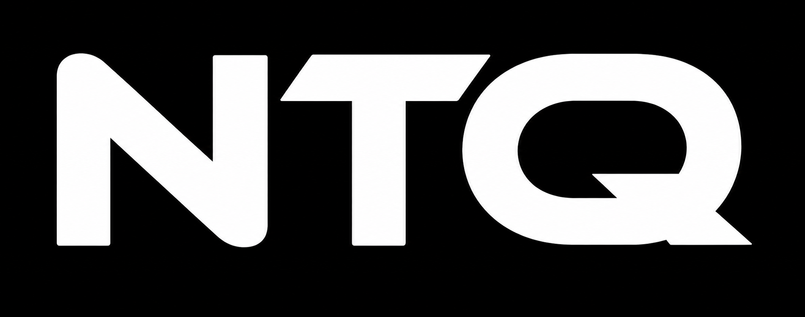

<h1 align="center">
   
</h1>

  A Windows desktop style portfolio with a built-in terminal

  
  
  

---

## Overview

This is my personal portfolio presented as a retro Windows XP desktop. Instead of a regular scrolling page, visitors boot into a desktop where each section of my portfolio is an icon that opens in its own draggable, resizable window. There is also a fully working **Terminal** app for exploring the portfolio with keyboard commands.

## Features

- **Boot screen** with an animated loading bar before the desktop appears
- **Windows XP desktop** with icons, a Start menu, taskbar, and a live clock
- **Window management**: drag, resize, minimize, maximize, close, and focus stacking
- **Taskbar** buttons that track and restore open windows
- **Terminal app** with a typed boot sequence, command history, and tab autocomplete
- **Keyboard accessible**: `Tab` to move between icons, `Enter` to open them